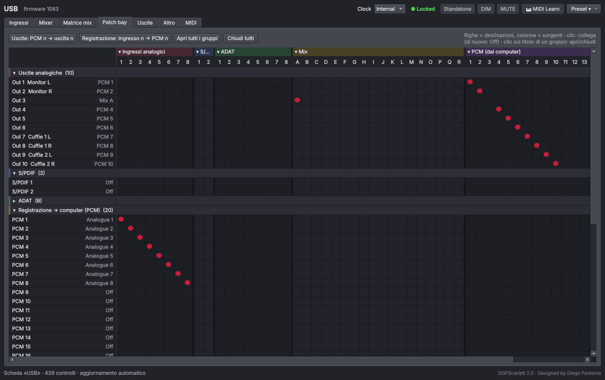
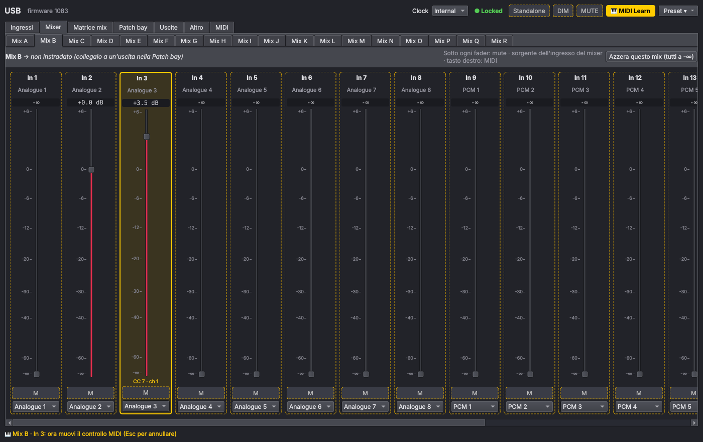
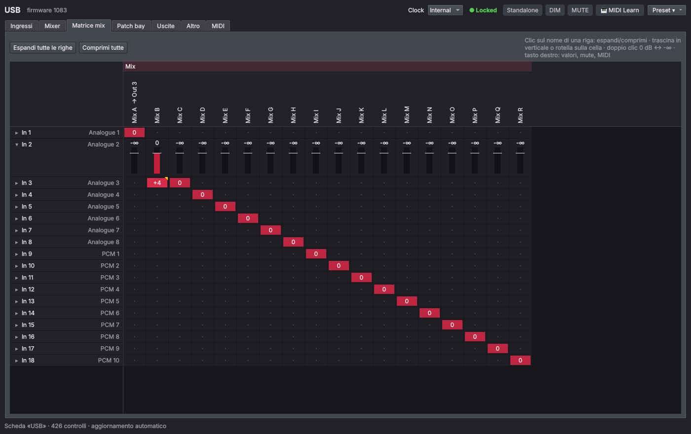

# DGFScarlett

*Designed by Diego Fantoma*

Pannello di controllo per le schede audio **Focusrite Scarlett / Clarett** su Linux, con patch bay a matrice, mixer a fader e controllo da superficie **USB MIDI** con *MIDI learn*.

Usa i controlli ALSA esposti dal driver `scarlett2` del kernel (gli stessi che Focusrite Control usa su Windows/macOS) tramite `amixer`. Pensato per la **Scarlett 18i20 2ª gen.**, funziona con ogni modello supportato dal driver: le sezioni si costruiscono dai controlli che la scheda espone.



## Funzioni

| Scheda | Cosa fa |
|---|---|
| **Ingressi** | Line/Inst, pad, phantom 48 V (con conferma) e gli altri controlli d'ingresso del modello |
| **Mixer** | Un sotto-tab per ogni mix (A…R), un fader per ogni ingresso del mixer con scala in dB, mute, sorgente e indicazione delle uscite su cui è instradato il mix |
| **Matrice mix** | Ingressi × mix in un colpo d'occhio. Trascina o usa la rotella sulle celle, doppio clic 0 dB ↔ -∞. **Righe espandibili**: clic sul nome per vedere i livelli come barre |
| **Patch bay** | Matrice destinazioni × sorgenti (uscite analogiche, S/PDIF, ADAT, PCM verso il computer, ingressi del mixer). Clic per collegare, di nuovo per scollegare. **Gruppi di righe e di colonne richiudibili** |
| **Uscite** | Fader di volume, mute, modo HW/SW (manopola o software) e sorgente per ogni uscita |
| **MIDI** | Scelta delle porte, elenco delle assegnazioni, pickup (soft takeover), monitor dell'ultimo messaggio |
| **Altro** | Tutti i controlli restanti della scheda |

I fader hanno una curva da mixer (0 dB a circa 3/4 della corsa). Lo stato della scheda viene riletto ogni 1,5 s, quindi la manopola Monitor e i tasti della scheda si vedono anche nel pannello. Lo stato apertura/chiusura dei gruppi e delle righe nelle matrici viene ricordato.

### MIDI learn

1. Nella scheda **MIDI** spunta la porta del controller.
2. Premi **🎹 MIDI Learn** in alto (o `Ctrl+L`): i controlli assegnabili si bordano di giallo.
3. Clicca un fader, un pulsante (mute, DIM…) o una cella della matrice mix.
4. Muovi il fader o la manopola (o premi il tasto) sul controller: fatto. Puoi continuare con il controllo successivo; `Esc` per uscire.

In alternativa: tasto destro su un fader → *MIDI learn…*.

- Fader: Control Change o Pitch Bend (fader in stile Mackie a 14 bit).
- Pulsanti e mute: Note o CC (ogni pressione commuta).
- **Pickup**: con controller non motorizzati il fader segue il controller solo dopo averlo "agganciato", evitando salti di livello.

L'ingresso MIDI usa il sequencer ALSA tramite `aseqdump` (alsa-utils), in un processo separato: il controller resta usabile anche da altri programmi e un problema MIDI non può far cadere la finestra. `python-rtmidi` si usa solo se `aseqdump` manca, o forzandolo con `DGFSCARLETT_MIDI=rtmidi`; `DGFSCARLETT_MIDI=off` disattiva il MIDI. Le assegnazioni stanno in `~/.config/dgfscarlett/config.json`.

| Mixer con MIDI learn | Matrice mix con righe espandibili |
|---|---|
|  |  |

## Installazione

```bash
git clone https://github.com/<utente>/DGFScarlett.git
cd DGFScarlett
./install.sh
```

Crea un ambiente Python con PySide6 in `~/.local/share/dgfscarlett`, il comando `dgfscarlett` e una voce nel menu delle applicazioni. Disinstallazione: `./install.sh --uninstall`.

Senza installare: `./run.sh` dalla cartella del progetto. Usa PySide6 se c'è già (sistema o ambiente di `install.sh`), altrimenti crea da solo un ambiente `.venv` nella cartella al primo avvio. Accetta le stesse opzioni e gli stessi comandi del programma (`./run.sh list Mix`, `./run.sh --card USB`).

Requisiti: Linux con kernel 6.7+ (driver `scarlett2` attivo di default; sui kernel precedenti per la 2ª gen. serve `options snd_usb_audio vid=0x1235 pid=0x8201 device_setup=1`), `alsa-utils`, Python 3.8+.

## Riga di comando

```text
dgfscarlett list [filtro]          elenco dei controlli con il valore attuale
dgfscarlett get "NOME"             valore di un controllo
dgfscarlett set "NOME" VALORE      numero grezzo, «-12dB», on/off, voce di menu («PCM 3»)
dgfscarlett save FILE.json         salva lo stato della scheda (preset)
dgfscarlett load FILE.json         ripristina un preset
dgfscarlett midi-ports             porte MIDI in ingresso disponibili
opzione:  --card ID                id ALSA della scheda (predefinita: la prima Focusrite)
```

I comandi da terminale funzionano anche senza PySide6.

## Sviluppo

Senza la scheda si può usare il simulatore di una 18i20 2ª gen.:

```bash
DGFSCARLETT_AMIXER=tests/fake_amixer.py ./dgfscarlett.py --card USB
python3 -m unittest discover -s tests
```

## Licenza

MIT — vedi [LICENSE](LICENSE). Designed by Diego Fantoma. Focusrite, Scarlett e Clarett sono marchi di Focusrite Audio Engineering Ltd.; questo progetto non è affiliato a Focusrite.
